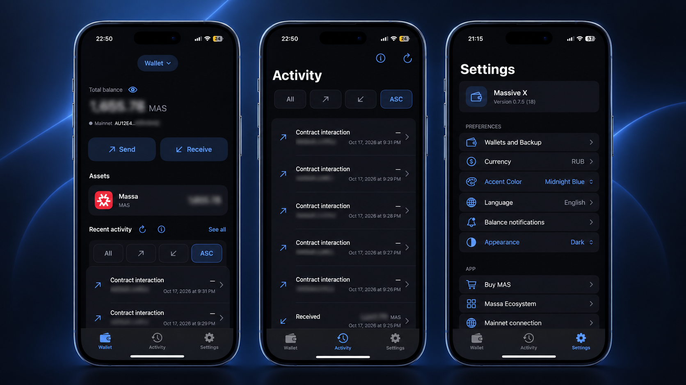

# Massive X iOS

A native SwiftUI wallet for Massa Mainnet. iPhone, iOS 17 or later.

Source version **0.7.5 (18)**, verified locally. This source publication does not indicate Apple approval or TestFlight availability.

## Preview

<p align="center">
  <a href="./screenshots/mainios.png">
    
  </a>
</p>

Six app languages: English, French, Russian, Spanish, Simplified Chinese and German.

Website: https://massive-x.com/ · Contact: info@massive-x.com

Independent community wallet; not affiliated with or endorsed by Massa Labs.

## Features

- Create or import an owned Massa account, import supported encrypted single-account Version 1 YAML, add watch-only addresses, rename/select wallets, and remove only the selected wallet.
- Per-wallet device-only Keychain storage with Face ID or device passcode, authenticated private-key backup and explicit clipboard consent. Logout requires backup self-attestation and fresh device-owner authentication; the declaration is not proof of a usable backup.
- Mainnet balances, native receive QR/copy/share, real operation history, exact MAS amount entry, fee-aware Max, immutable transfer review and deliberate slide-to-submit confirmation.
- Standard Debug and Release Mainnet Send with protected local signing, durable pending records, duplicate prevention and conservative reconciliation. No automatic retransmission of ambiguous operations. New AU recipients are supported subject to verified account-creation costs; unsupported recipient types remain blocked.
- Fiat/crypto estimates, theme and accent preferences, alternate app icons, localized settings, privacy-safe local balance-change notifications, and external exchange/ecosystem links.

## Build

The project uses Swift 6, Apple frameworks and vendored C dependencies. No package download, Node runtime or external font is required to build the app. Recovery uses private keys or supported YAML files; mnemonic derivation is not implemented. Verified with Xcode 27.1; an earlier Xcode version has not been qualified for this snapshot.

Clone this repository, then open `MassiveX.xcodeproj`, choose the **MassiveX** scheme and an iPhone simulator. For a Release simulator build:

```sh
xcodebuild -project MassiveX.xcodeproj -scheme MassiveX -configuration Release \
  -destination 'generic/platform=iOS Simulator' -derivedDataPath /tmp/massivex-release \
  CODE_SIGNING_ALLOWED=NO build
```

Signing is disabled only for that simulator command. For a physical device, configure your own development team and provisioning locally. No owner team, certificate, provisioning profile or private entitlement is provided. Never use another installation's wallet data to test a build.

The checked-in project can be reproduced with `python3 scripts/generate_project.py`. Regeneration replaces local project settings, so preserve any personal signing configuration first. All required icons/assets, six localization catalogs, Info.plist and the privacy manifest are included.

## Tests

Unit tests use mocks and disposable public vectors; see [test safety and coverage](MassiveXTests/README.md). The isolated runner copies source to a fresh test namespace and replaces only its host entry point. For example, choose an available simulator UUID and run:

```sh
python3 scripts/run_transfer_security_checks.py /tmp/massivex-unit-checks SIMULATOR_UUID \
  --canonical-project MassiveX.xcodeproj/project.pbxproj \
  --only MassaCoreTests/testOfficialSDKSignaturesAndTampering \
  --only OperationIDTests/testFourIndependentSDKAndCoreFormulaOperationIDs
```

Use a new output directory each time. This does not install or launch the shipping app, read an existing wallet container, or submit a transaction. Do not automate funded wallet interactions. The optional DEBUG-only Keychain diagnostic referenced by the app entry point is retained; it uses a separate disposable public-test namespace and is not part of normal navigation.

## Network and security model

Mainnet JSON-RPC: `https://mainnet.massa.net/api/v2`, chain ID 77658377. Strictly matching final execution reports from this official Massa Labs provider are accepted operationally only after durable terminal-resolution storage. This is **trust in the provider**, not independent cryptographic verification. Missing/pruned/speculative data, request failure and expiry alone do not resolve an ambiguous payment.

For a pruned successful basic MAS operation, a separate explicit historical review can accept two matching official Explorer reports and finalized-block membership only after exact canonical operation/signature checks, fresh device-owner authentication, post-authentication revalidation and durable source-bound storage. This is owner-accepted indexed evidence, not RPC confirmation or independent consensus verification. Missing, failed, contradictory or mismatched evidence stays locked. Every new payment still requires fresh review and protected authorization; historical recovery never resubmits an old operation.

Address history uses the official explorer indexer at `https://explorer-api.massa.net`; its contract is unversioned and is not a complete independent chain proof. Quote providers include CoinGecko and Frankfurter; coverage and freshness vary. Public addresses are sent to network services when their data is requested. No private key is sent to them. External exchange links do not connect exchange accounts or transfer funds automatically.

Keychain user presence is not Secure Enclave-backed Ed25519 signing. Device loss requires a valid private backup; screenshots, clipboard exposure, memory zeroization, local journal rollback and cross-store crash consistency have limitations. Background notifications are opportunistic; iOS does not guarantee real-time execution. This source snapshot is not a claim of an independent audit, security certification or public-release readiness.

## Dependencies and rights

The original application source code is licensed under the [MIT license](LICENSE), copyright (c) 2026 Fedor Ovchinnikov. Application artwork, icons, branding, names and trademarks are excluded from that source-code grant. See [artwork and trademark terms](ASSETS_AND_TRADEMARKS.md) for the separately treated imagery and limited descriptive use of third-party marks. No third-party trademark license or endorsement is claimed.

See [vendored dependency versions, licenses and checksums](Vendor/README.md). Their existing upstream licenses and copyright notices remain unchanged and govern those components separately.

## Source snapshot

This public tree exports development snapshot `97147f41a08d92db39951185487efd4656cfb2be`, including the input fixes in `64bf510` and authenticated historical recovery in `474a2d7`. These provenance identifiers are distinct from this public repository’s commit history and from Apple build or release records. Private development history, signing overrides and internal verification material are not included.
